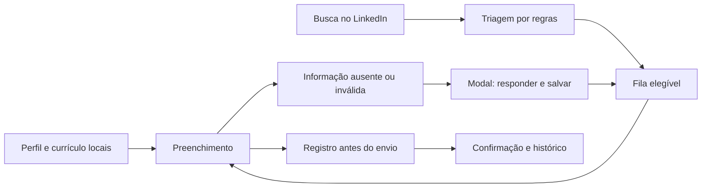
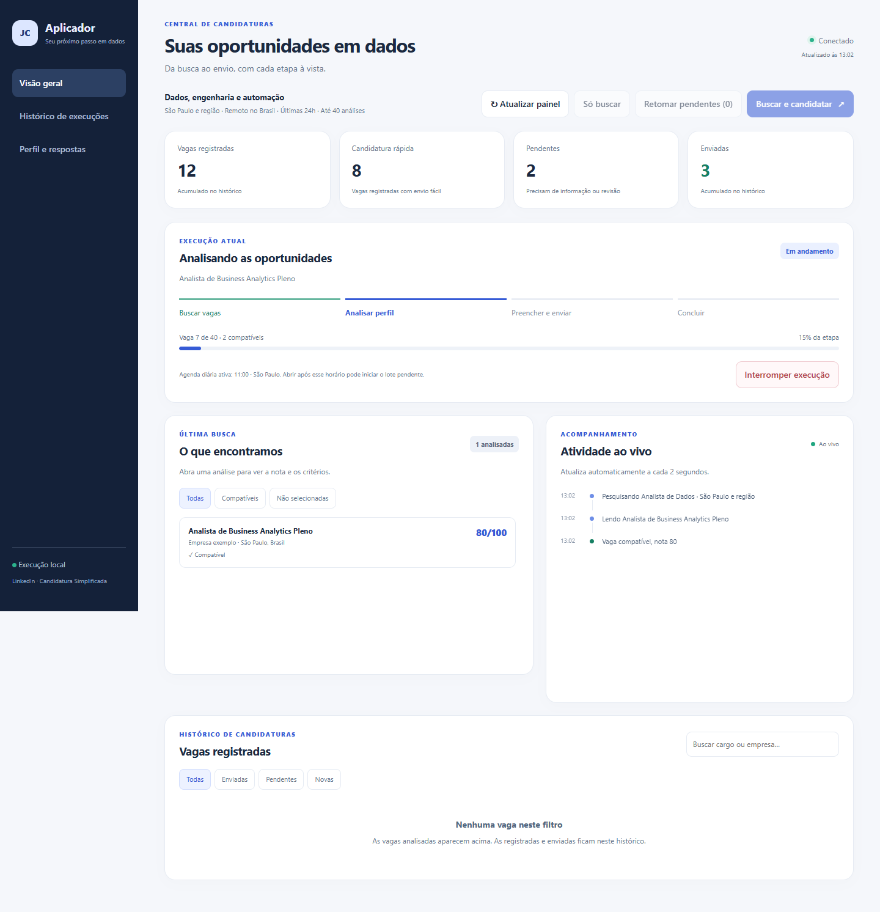
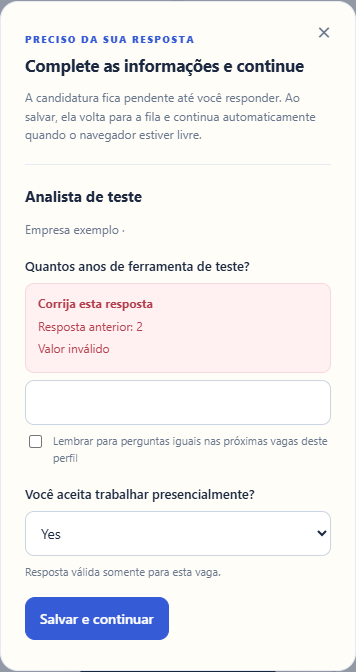

# Job Applier

Aplicação local para buscar vagas no LinkedIn, fazer uma triagem explicável e preencher candidaturas simplificadas com respostas confirmadas pelo candidato.

O painel reúne progresso, atividade ao vivo, perguntas pendentes e histórico de envios. Quando falta uma resposta ou o LinkedIn rejeita um valor, um modal permite corrigir, salvar e retomar a candidatura.

**Status:** protótipo local para Windows e um perfil por instalação. Os dados do candidato são configurados manualmente em JSON e o currículo fica em um PDF local. Upload e extração automática de currículo, matching dirigido pelo currículo, contas e vários usuários ainda estão no [roadmap](docs/ROADMAP.md).

## Funcionalidades

- Busca de vagas com Candidatura Simplificada, por títulos relacionados a Dados/BI, Engenharia de Dados júnior, integração, qualidade de dados e automação.
- São Paulo e região ou remoto no Brasil; janela inicial de 24 horas, configurável.
- Triagem por regras com nota, critérios e motivos de descarte visíveis.
- Painel responsivo, atualização a cada dois segundos, log de atividade e histórico de execuções.
- Preenchimento de campos, seleções e rádios; upload e seleção do currículo por identificação do conteúdo.
- Modal de perguntas novas e de respostas rejeitadas, com gravação local e retomada em fila.
- Respostas reutilizáveis em perguntas iguais ou restritas à vaga. Condições de trabalho e salário ficam restritos à vaga.
- Registro antes do clique de envio e bloqueio de novas tentativas quando já há um registro de submissão.

**O matching atual usa regras fixas para esse conjunto de cargos e competências. Ele ainda não compara qualquer currículo com qualquer vaga e não usa IA.** Indeed e Gupy não têm envio automático implementado. O projeto depende da interface do LinkedIn, pode precisar de manutenção e não garante candidatura ou contratação.

## Começar

Requisitos: Windows, Git, Python 3.11 ou superior, Node.js 22 ou superior e Chrome ou Edge instalado. O projeto funciona sem Codex; eventuais caminhos de runtime no código são apenas alternativas de detecção.

```powershell
git clone https://github.com/joaochvs/job-applier.git
cd job-applier
python setup.py
cd job-applier-app
npm ci --ignore-scripts
cd ..
```

Depois:

1. Preencha `data/profile.json` com seus contatos, conhecimentos e respostas reais. Veja o [guia de configuração](docs/CONFIGURACAO.md).
2. Copie seu currículo PDF para `data/resume.pdf`. Alternativamente: `python setup.py --resume "C:\caminho\curriculo.pdf"`.
3. Execute `python setup.py --check` para conferir os arquivos e contatos básicos.
4. Execute `node job-applier-app/login.js` e faça login manualmente no LinkedIn na janela dedicada.
5. Execute `python job-applier-app/app.py` ou abra `job-applier-app/start.bat`.

O painel abre em [localhost:8765](http://127.0.0.1:8765). Use inicialmente **Só buscar** para conferir os resultados. **Buscar e candidatar** e **Preencher e enviar** iniciam envios reais. A agenda vem **desativada por padrão**; se habilitada, depende do servidor aberto. Não é um serviço em nuvem.

## Como funciona



As respostas são fatos fornecidos pelo usuário. O app não cria anos de experiência para ferramentas desconhecidas. Perguntas em meses convertem anos cadastrados em meses; dúvidas sem unidade clara ficam pendentes. CAPTCHA, login e documentos não reconhecidos exigem intervenção manual.

## Documentação

| Guia | Conteúdo |
|---|---|
| [Uso diário e resolução de problemas](docs/USO.md) | Botões, modal, agenda, histórico, erros e retomada |
| [Configuração](docs/CONFIGURACAO.md) | Perfil, competências, preferências, busca e variáveis de ambiente |
| [Implementação atual](docs/IMPLEMENTACAO.md) | Módulos, API, pontuação, arquivos e estados |
| [Arquitetura futura](docs/ARQUITETURA.md) | Upload, extração, matching por currículo e vários usuários |
| [Roadmap](docs/ROADMAP.md) | O que está pronto e próximas etapas |
| [Privacidade e publicação](docs/PUBLICACAO.md) | O que fica fora do Git e como revisar uma alteração |
| [Contribuição](CONTRIBUTING.md) | Desenvolvimento e testes |
| [Histórico de mudanças](CHANGELOG.md) | Conteúdo da primeira versão pública |

## Testes

Após instalar as dependências e executar `python setup.py`, rode a partir da raiz:

```powershell
python -m unittest discover -s tests -p "test_*.py"
python -m unittest discover -s job-applier-app -p "test_*.py"
cd job-applier-app
npm test
```

Os testes usam perfil e PDF fictícios, HTML local e API simulada. Não precisam de login e não enviam candidaturas. Os testes de interface precisam de Chrome/Edge; use `JOB_APPLIER_BROWSER` para indicar outro caminho. O workflow do GitHub executa os mesmos testes em Windows.

## Dados locais

`data/`, `runtime/`, `output/`, perfis de navegador, configurações locais, currículos e históricos reais não são versionados. A única exceção de PDF é uma fixture fictícia de teste. Exemplos e screenshots são demonstrativos; não contêm currículo nem histórico real do autor. Use uma instalação separada para cada pessoa. A interface mostra dados do perfil, mas ainda não possui um editor completo de currículo/contatos.

## Prévia

Dados fictícios de demonstração:





## Licença

Ainda não foi definida uma licença de distribuição. O pacote está marcado como `UNLICENSED`; não há declaração de licença ISC para o código do projeto. As dependências mantêm suas próprias licenças.
