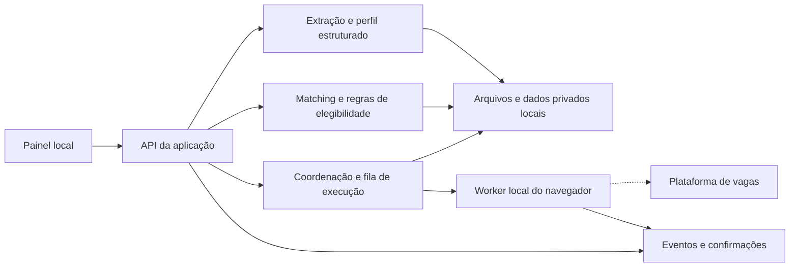

# Desenho do produto e arquitetura proposta

Este documento descreve uma evolução futura. O fluxo atual está documentado em IMPLEMENTACAO.md. A configuração local já é genérica; upload, extração e matching dirigido pelo currículo ainda não estão implementados.

## Experiência da pessoa

1. **Anexar currículo:** PDF com texto ou DOCX. Mostrar nome do arquivo, progresso e eventual falha de leitura. Um PDF escaneado deve ser identificado; OCR entra em uma etapa posterior.
2. **Revisar perfil:** apresentar contato, experiências, datas, formação, ferramentas e idiomas. Cada informação extraída mostra de onde veio e pode ser corrigida. Diferenciar experiência profissional, projeto, curso e conhecimento declarado.
3. **Completar respostas:** perguntar somente o que o currículo não informa: anos por ferramenta, disponibilidade, pretensão salarial por regime, modalidade e outras preferências. Não concluir que todas as ferramentas têm o mesmo tempo de experiência sem declaração da pessoa.
4. **Escolher o alvo:** famílias de cargos, senioridade por família, locais, modalidade, regime, janela de publicação, exclusões e limite por execução.
5. **Ver oportunidades:** explicar correspondências, requisitos ausentes e incertezas. A pessoa pode abrir a vaga e a evidência do currículo usada na comparação.
6. **Escolher como candidatar:** somente busca, preenchimento assistido ou envio automático previamente habilitado para aquele perfil e conjunto de preferências.
7. **Acompanhar:** atividade em tempo real, motivo das pendências, resultado confirmado de cada envio e histórico pesquisável.

## Desenho da interface futura

```text
┌─────────────────────────────────────────────────────────────┐
│ Meu perfil    Oportunidades    Execuções    Configurações     │
├─────────────────────────────────────────────────────────────┤
│ Currículo anexado             Perfil revisado / pendências   │
│ Famílias de vagas e localização       [Buscar oportunidades] │
├──────────────────────────────┬──────────────────────────────┤
│ Oportunidades                │ Atividade ao vivo            │
│ Cargo · empresa · local      │ Extraindo currículo          │
│ Compatibilidade explicada    │ Pesquisando cargos           │
│ Evidências e requisitos     │ Analisando requisitos        │
│ [Ver detalhes] [Candidatar]  │ Preenchendo / envio confirmado│
├──────────────────────────────┴──────────────────────────────┤
│ Histórico: enviadas · pendentes · falhas · resultado incerto │
└─────────────────────────────────────────────────────────────┘
```

Em celular, os blocos são empilhados. Progresso e atividade ficam disponíveis sem depender de uma janela de terminal.

## Arquitetura lógica do primeiro produto

Os blocos abaixo são responsabilidades internas, não uma proposta de microserviços. O primeiro produto deve continuar simples: uma aplicação local e um processo de navegador.



### Componentes

| Componente | Agora | Evolução proposta |
|---|---|---|
| Interface | Painel HTML/CSS/JS responsivo | Manter inicialmente; componentes e onboarding conforme a complexidade crescer |
| API | Servidor Python com rotas próprias | API organizada por perfil, currículos, vagas, matching e execuções; FastAPI é uma opção para a migração |
| Currículo | PDF privado configurado na instalação local | Upload, extração de PDF/DOCX, validação e versionamento |
| Perfil | Banco JSON local, respostas confirmadas e escopo por vaga | Modelo estruturado genérico, revisável e com origem das informações |
| Matching | Regras para um conjunto de competências | Regras dirigidas pelo perfil, requisitos separados e explicações com evidências |
| Execução | Python coordena um worker Node/Playwright | Worker local isolado, comandos de iniciar/parar/retomar e adaptadores por plataforma |
| Persistência | CSV, JSON e arquivos locais | Migrações e armazenamento estruturado; PostgreSQL na versão com contas e vários usuários |
| Eventos | Log local e consulta periódica | Manter polling no primeiro produto; SSE pode substituir quando necessário |
| IA | Não utilizada | Opcional para estruturar texto e comparar requisitos; não é necessária para o primeiro produto genérico |

A autenticação da plataforma de vagas continua no navegador local da pessoa. O servidor do projeto não deve receber senha nem copiar a sessão do LinkedIn para uma conta compartilhada. Uma versão hospedada pode usar um agente local autenticado para buscar e preencher no computador da pessoa.

## Perfil estruturado

O perfil precisa guardar **fatos, origem, confiança da extração e confirmação da pessoa**. Exemplo em `examples/profile.example.json`.

- Contato e localização preferida.
- Histórico profissional com datas e descrições.
- Conhecimentos separados entre trabalho, projetos e estudo.
- Anos por conhecimento: informado ou calculado apenas quando houver evidência suficiente, com revisão.
- Formação e seu estado real de conclusão.
- Idiomas e nível confirmado.
- Preferências de candidatura e respostas reutilizáveis.
- Versão e identificação do currículo aprovado para anexar.

Não inferir autorização de trabalho, deficiência, salário atual, disponibilidade, certificação ou experiência profissional a partir de silêncio no currículo.

## Matching explicado

A nota deve depender do currículo de cada pessoa, e não de uma lista fixa das ferramentas do autor do projeto.

1. Normalizar títulos e termos equivalentes, mantendo os termos originais.
2. Separar requisitos obrigatórios, desejáveis e informações sobre a empresa.
3. Checar primeiro os impedimentos: local incompatível, senioridade, idioma obrigatório ou qualificação essencial ausente.
4. Comparar cada requisito com fatos do perfil revisado. Registrar a evidência usada.
5. Calcular uma nota por família e retornar correspondências, lacunas e incertezas.
6. Encaminhar dados insuficientes para revisão. Uma nota alta não deve apagar um impedimento obrigatório.

A nota representa a regra de priorização do produto; não é uma probabilidade de contratação nem reproduz a decisão de um ATS.

Exemplo de explicação futura:

```json
{
  "family": "data_engineering",
  "decision": "review",
  "matches": [
    {"requirement": "SQL", "evidence": "Experiência profissional confirmada no perfil"}
  ],
  "unknowns": [
    {"requirement": "Orquestração de pipelines", "reason": "Não há informação confirmada no currículo"}
  ],
  "blocking_requirements": []
}
```

O matching continua útil mesmo que a candidatura não seja simplificada: esses casos podem aparecer para análise e candidatura manual, fora da fila de envio automático.

## Uso opcional de IA

Uma etapa posterior pode usar um modelo para extrair currículos e estruturar requisitos, mantendo saída validada por esquema e evidências de origem. O modelo pode redigir uma apresentação a partir de fatos confirmados; não deve criar certificações, experiência ou respostas para preencher lacunas.

Currículos e anúncios são dados, não instruções. Texto dentro deles não pode alterar regras, autorizar envios ou comandar ferramentas. O modelo de matching não recebe permissão para clicar no navegador. Se a pessoa escolher um provedor externo, deve saber quais dados serão enviados; credenciais ficam fora do repositório e do navegador do front-end.

## Dados e eventos

O protótipo agora coleta perguntas desconhecidas com tipo e opções, permite responder no painel e grava respostas no banco do perfil local. Cada resposta guarda pergunta original, origem, data e escopo (vaga específica ou reutilizável em perguntas iguais). Uma fila persistente retoma a candidatura sem competir pelo navegador. Falta de resposta é uma pendência de informação; falha técnica e desafio de segurança permanecem estados diferentes.

Na versão com vários usuários, associar também cada resposta e item da fila a `profile_id` e à versão do currículo. O worker deve carregar o banco da pessoa antes de preencher. Nunca inferir uma nova experiência profissional apenas da duração total do currículo. Reutilização semântica entre perguntas diferentes deve mostrar a interpretação e pedir confirmação quando alterar ferramenta, nível, período ou condição da vaga.

Entidades propostas: perfil, versão de currículo, fato confirmado, preferências, vaga, requisito, avaliação de matching, execução, candidatura, resposta e evento.

Uma candidatura tem estados explícitos: selecionada, preenchendo, precisa de informação, pronta, envio iniciado, enviada, resultado incerto, interrompida e falha. Gravar a tentativa antes do clique final e confirmar o resultado depois. Nunca repetir automaticamente um envio incerto.

Na versão com contas, todos os registros e arquivos precisam pertencer a uma pessoa e ter verificações de acesso. Uma pessoa não pode consultar, anexar ou executar com o currículo ou a sessão de outra. Esses controles precisam ser testados antes de abrir o produto a vários usuários.

## Como o projeto demonstra engenharia de dados

O próprio produto contém uma cadeia de dados verificável: ingestão de documentos e vagas, normalização, entidades estruturadas, enriquecimento, validação de qualidade, matching, persistência e rastreabilidade. Para o portfólio, mostrar esse fluxo com dados fictícios é mais convincente do que apenas demonstrar cliques automatizados.
