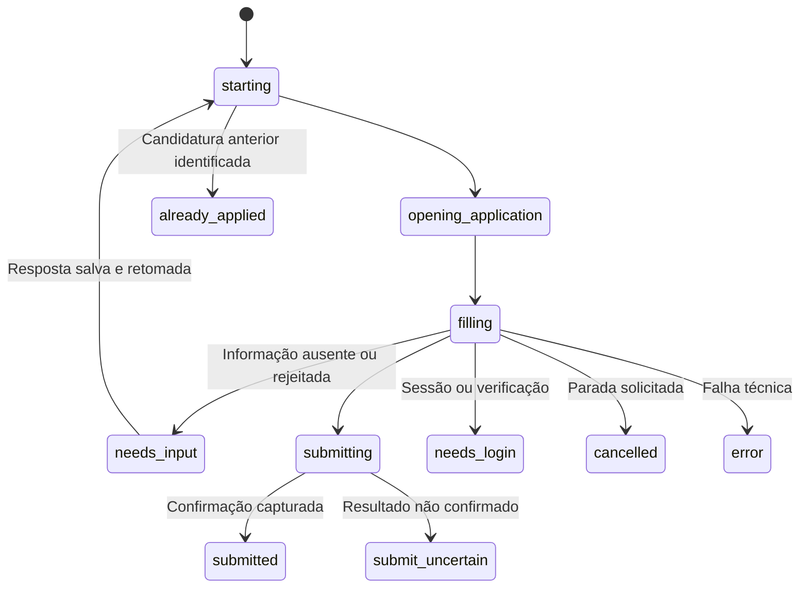

# Implementação atual

## Componentes

| Arquivo | Responsabilidade |
|---|---|
| `setup.py` | Cria configuração privada e tracker, sem sobrescrever arquivos existentes |
| `job-applier-app/app.py` | Servidor HTTP local, API, agenda e fila persistente de retomada |
| `daily.py` | Busca/seleção, trava de execução, coordenação sequencial, relatórios e atualização do tracker |
| `scout.js` | Navega nas buscas, reúne links, lê descrições e registra triagem |
| `matching.js` | Títulos equivalentes, famílias, localização, exclusões e pontuação |
| `job-page.js` | Lê cabeçalho e seção da vaga, aguarda carregamento e separa conteúdo da empresa |
| `answers.js` | Resolve respostas factuais, duração e alternativas; pergunta desconhecida retorna `null` |
| `worker.js` | Preenche a candidatura, anexa PDF, identifica campos pendentes e erros de validação |
| `form-flow.js` | Localiza modal/página de candidatura, botões e mudanças de etapa |
| `submission.js` | Grava tentativa antes do clique, espera confirmação e bloqueia repetição |
| `browser.js` / `login.js` | Sessão local dedicada, CDP e login manual |
| `config.js` | Localiza a pasta de dados da instalação |
| `events.js` | Emite eventos locais para o painel |
| `static/` | HTML/CSS/JavaScript do painel e modal, sem framework frontend |
| `scripts/` | Leitura/escrita de tracker e preparação de dossiê |

## Pontuação e elegibilidade

A nota é uma heurística por palavras e contexto, não uma probabilidade. O padrão exige nota mínima 75, Candidatura Simplificada, empresa identificada e ausência de lacunas impeditivas.

| Critério | Dados/BI | Engenharia/integração | Automação |
|---|---:|---:|---:|
| Cargo relacionado | 25 | 25 | 25 |
| SQL/bancos | 20 | 20 | 5 |
| BI | 20 | — | — |
| Dashboards/indicadores | 15 | — | — |
| Análise de negócio | 10 | — | — |
| Python | Incluído nos 5 abaixo | 20 | 25 |
| Python/APIs/automação | 5 | — | — |
| Excel/Power Query | 3 | — | — |
| Modelagem/qualidade/armazenamento | 2 | 10 | — |
| ETL/pipelines | — | 15 | — |
| APIs/integrações | — | 5 | 20 |
| Git | — | 5 | 5 |
| Automação de rotinas | — | — | 10 |
| Tratamento/fluxo de dados | — | — | 10 |

Títulos de liderança, sênior/especialista, arquitetura, ciência de dados e automação industrial são excluídos. Engenharia pleno/sênior fica fora; títulos genéricos de Engenharia precisam indicar júnior no título/descrição. Exigência explícita de mais de três anos e algumas plataformas obrigatórias desconhecidas geram lacuna. Essa verificação não cobre todos os requisitos de uma vaga e ainda não é parametrizada pelo currículo.

As consultas padrão usam rodízio para não consumir o limite todo com o primeiro termo. Há deduplicação por ID/URL e, no tracker, por empresa/cargo/local. A localização é conferida depois de ler a vaga. Falha na leitura não equivale a falta de compatibilidade: três falhas consecutivas interrompem a busca com erro.

## Estados da candidatura



O CSV mantém o rótulo legado `Aguardando aprovação`; a interface o apresenta como pendência. O JSON do worker distingue informação ausente, falha, login e incerteza de envio. Um journal existente impede retentativa mesmo que o CSV seja editado.

Não há garantia matemática de exatamente um envio entre sistemas: a plataforma é externa e a interface muda. O journal reduz duplicação e preserva a incerteza em vez de tratar ausência de confirmação como falha segura para repetição.

## Campos inválidos e aprendizado

O worker captura campos e opções quando falta resposta. Em validações, procura `aria-invalid`, validade nativa e mensagens vinculadas por acessibilidade ou próximas ao campo. Registra `question`, `type`, `options`, `max_length`, `error` e `previous_answer`, conforme disponível.

O servidor valida se a pergunta pertence à pendência atual, confere números/opções/tamanho, rejeita o mesmo valor já recusado e grava as respostas atomicamente. Para reutilização global corrigida, remove a resposta específica antiga da mesma vaga que teria prioridade. O modal limpa o rascunho rejeitado e mostra o motivo para a pessoa informar outro valor.

`runtime/answer-resume-queue.json` persiste a retomada. O servidor verifica a fila a cada dois segundos e só inicia quando o navegador não está ocupado. A parada esvazia essa fila. Não existe geração por IA nem reutilização semântica de respostas.

## API local

Não há autenticação multiusuário. O servidor é local, em `127.0.0.1`, e não deve ser exposto como serviço público.

| Método e rota | Função |
|---|---|
| `GET /api/live` | Execução, busca, eventos, triagem e configuração |
| `GET /api/jobs` | Vagas, pendências, campos e elegibilidade de retomada |
| `GET /api/summary` | Contadores do histórico |
| `GET /api/profile` | Perfil, competências e respostas aprendidas |
| `GET /api/runs` | Histórico de lotes |
| `GET /api/automatic/status` | Situação da execução e agenda |
| `GET /api/search/status`, `/api/search/audit` | Situação e análise da busca |
| `GET /api/worker/ID` | Estado de preenchimento da vaga |
| `GET /api/dossier/ID` | Dossiê local preparado para a vaga |
| `POST /api/search/start`, `/api/search/import` | Iniciar busca e importar elegíveis |
| `POST /api/automatic/start` | Busca e candidaturas reais |
| `POST /api/automatic/retry` | Retomar pendentes |
| `POST /api/automatic/stop` | Solicitar parada e cancelar fila de retomada |
| `POST /api/jobs/ID/apply` | Candidatar a uma vaga elegível |
| `POST /api/jobs/ID/answers` | Salvar respostas da pendência e enfileirar retomada |
| `POST /api/jobs/ID/status` | Atualizar estado do tracker |
| `POST /api/jobs/ID/prepare` | Preparar dossiê local |
| `POST /api/jobs/ID/submit` | Comando legado para worker aguardando confirmação |

Exemplo do corpo de resposta, com dados fictícios:

```json
{"answers":[{"question":"Quantos anos de ferramenta de teste?","answer":"2","remember":true}]}
```

## Arquivos de execução

| Caminho | Conteúdo |
|---|---|
| `data/profile.json` | Fatos e respostas confirmadas desta instalação |
| `data/resume.pdf` | Currículo privado |
| `data/jobs.csv` | Tracker de vagas e candidaturas |
| `data/browser-profile/` | Cookies e sessão do navegador |
| `job-applier-app/automation.json` | Busca, agenda e limites locais |
| `job-applier-app/runtime/events.jsonl` | Eventos da execução atual |
| `job-applier-app/runtime/search-*.json` | Resultados e análise da busca |
| `job-applier-app/runtime/ID.json` | Estado e perguntas da candidatura |
| `job-applier-app/runtime/ID.submission.json` | Registro de tentativa/resultado do envio |
| `job-applier-app/runtime/automatic.lock` | Trava entre coordenadores |
| `output/daily-runs/` | Relatórios e marcador diário |

Todos esses dados são locais e ignorados pelo Git. É uma arquitetura para uma instalação pessoal; não há transações distribuídas nem isolamento por conta.
